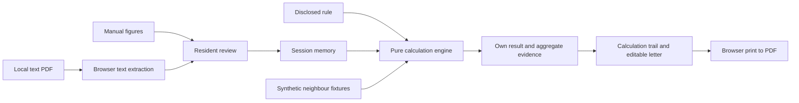

# Architecture and decisions

## Current demonstration

No record is sent to a backend. No session is stored in localStorage, cookies, or an external database. Third-party fonts are self-hosted. Dependency downloads occur at build time. The static host will still receive ordinary requests for app assets; this is not a claim of anonymous network access.

The client contains all synthetic fixtures. UI privacy in a demo does **not** provide confidentiality for real residents. A production implementation must move the cohort and calculation to an authorized server.

## Calculation contract

For each active factor `f`:

`share(i) = sum(weight(f) × householdFactor(i,f) / buildingTotal(f))`

`impliedPool(i) = utilityCharge(i) / share(i)`

`consensus = median(impliedPool(all comparable households))`

`expected(i) = roundToCents(share(i) × consensus)`

`deviation(i) = (impliedPool(i) − consensus) / consensus`

Flag when `abs(deviation) > 0.02`. The threshold is a prototype product assumption, not a legal standard or statistical guarantee. Negative differences are under-consensus charges, not “savings.” Expected values remain estimates.

Input money is integer cents. Ratios are unrounded JavaScript numbers; comparison includes a tiny floating-point guard at the exact threshold. Only the final expected charge is rounded to cents. This avoids rounding percentage shares before doing the calculation. The displayed share is illustrative and may be rounded.

The optional master cross-check uses `masterBill × (1 − commonAreaFraction)` once. It does not deduct common areas from neighbour charges again. Billing fees stay outside the utility pool and may need a separate disclosure check.

Validation rejects incomplete active totals, invalid weights, missing factors, duplicate household IDs, incompatible cohorts, invalid amounts, and zero consensus. Three households is a minimum sample rule; it does not establish authenticity, representativeness, or adequate production privacy. Half or more unreliable entries can defeat the median. Even universal agreement cannot validate an inflated actual building cost.

## Interface state

Five pages form one client-side journey. Submitted statement data is separate from draft field strings. Every input change invalidates the previous check and report unlock. A result is always derived from the current confirmed statement, rule, participation state, and optional master bill. No stale saved result is reused.

The report’s letter is editable session state. Changing audited inputs remounts the report with a newly generated letter. Refresh resets the complete demonstration. Room links do not serialize financial data.

## Production boundary: Supabase pilot

Retain the pure engine; run it on the server using authorized data. Do not send the full room’s records to a client and hide them with CSS.

| Table         | Proposed fields and invariants                                                                                                                                                                                                                                                       |
| ------------- | ------------------------------------------------------------------------------------------------------------------------------------------------------------------------------------------------------------------------------------------------------------------------------------ |
| `buildings`   | UUID, display name, private room token hash, rule versions in JSONB, building totals, created_at. Rules belong to a period and utility; never silently apply edited rules to old reports.                                                                                            |
| `submissions` | UUID, building_id, owner_id, independently established household_id, period, utility, factors, utility_cents, fee_cents, rule_version, consent_at, provenance, timestamps. Unique active `(building_id, household_id, period, utility)`. Money constrained to non-negative integers. |
| `reports`     | UUID, owner_id, building_id, period, utility, engine_version, rule_version, cohort fingerprint, own input snapshot, permitted aggregate snapshot, result JSON, created_at. Immutable; supersede rather than overwrite.                                                               |

Membership and independently established household identity are needed in addition to these three domain tables. Anonymous auth alone does not prevent one person from contributing multiple “households.” A public room token is an invitation, not proof of residence or authority to read submissions. Choose a practical enrollment check with the pilot partner before implementing it.

Default deny via row-level security. A resident may create/read/update/delete only their own active submission and reports. Authorized server aggregation reads the eligible cohort and returns only the requester’s row, limited evidence counts, and approved aggregate values. Never expose raw records through general list endpoints or client service-role keys.

Aggregate counts and medians can still leak information in small rooms, especially through repeated additions/removals. The mathematical minimum of 3 is not a complete privacy policy. Before real data: define independent participation checks, a separate publication threshold, delayed/coarsened aggregates, anti-differencing controls, and tests against inference attacks.

Original documents, if needed, belong in private object storage with scoped signed URLs, explicit retention limits, owner deletion, and no document text in application logs. Storage paths and metadata must not expose names or account numbers. Server extraction credentials are runtime secrets.

## Non-goals for the hackathon

Real payments, legal judgments, authenticated residence verification, production anonymization, generalized OCR, live messages, notifications, arbitrary utilities, and historical monitoring. The UI calls these out rather than simulating a successful real service.

## Deployment and verification

`next build` emits the complete app into `out/`. Static export needs no Node server or environment variables. The PDF worker must ship with the same `pdfjs-dist` version used by the browser bundle. A build script copies it before each build.

Automated checks cover arithmetic and text parsing, and strict TypeScript checks the interface. They do not prove browser interaction, mobile rendering, screen-reader behavior, or print layout. Those require the release checklist and actual browser QA. The current task environment lacks the Sites browser-control tool and the installed Sites source/publish helpers, so a deployed URL and browser QA are not claimed.
