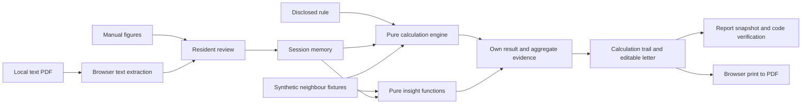

# Architecture and decisions

## Current demonstration

No record is sent to a backend. A saved fictional building ID is the only localStorage value; statements, report snapshots, and contact information are not stored. Third-party fonts are self-hosted. Dependency downloads occur at build time. The static host will still receive ordinary requests for app assets; this is not a claim of anonymous network access.

The interface uses Tailwind CSS utilities in the React components. `globals.css` contains only the Tailwind import, self-hosted fonts, theme tokens, focus styles, and print rules. The six views use a compact header and reveal detailed calculations only in the report.

The client contains four fictional building fixtures with six statements each. The building chooser gates the neighbour-comparison journey. The Moving view computes August, September, and October summaries through the allocation engine using separate synthetic monthly statements. An unlisted building has no neighbour comparison or history; its independent check calculates directly from the renter's entered statement, disclosed rule, building totals, and same-month master bill. If inputs are missing or invalid, it withholds a result and drafts a records request. This is a calculation on self-entered data, not document authentication. UI privacy in a demo does **not** provide confidentiality for real resident cohorts. A production shared room must move the cohort and calculation to an authorized server.

## Calculation contract

The independent check uses `eligiblePool = masterBill × (1 − commonAreaFraction)` and `expected = roundToCents(share × eligiblePool)`, where share uses the disclosed factor weights and building totals below. It requires a positive water charge, matching statement and master-bill months, weights totaling 100%, valid active factors and totals, and an explicit deduction value (including 0%). A missing document yields an evidence checklist and draft letter. Its 2% flag is a prototype tolerance, not a legal threshold. The separate billing fee does not enter the calculation. Unlike the neighbour median, this path does not need a cohort; its accuracy depends on the entered documents.

For each active factor `f`:

`share(i) = sum(weight(f) × householdFactor(i,f) / buildingTotal(f))`

`impliedPool(i) = utilityCharge(i) / share(i)`

`consensus = median(impliedPool(all comparable households))`

`expected(i) = roundToCents(share(i) × consensus)`

`deviation(i) = (impliedPool(i) − consensus) / consensus`

Flag when `abs(deviation) > 0.02`. The threshold is a prototype product assumption, not a legal standard or statistical guarantee. Negative differences are under-consensus charges, not “savings.” Expected values remain estimates.

Input money is integer cents. Ratios are unrounded JavaScript numbers; comparison includes a tiny floating-point guard at the exact threshold. Only the final expected charge is rounded to cents. This avoids rounding percentage shares before doing the calculation. The displayed share is illustrative and may be rounded.

The optional master cross-check uses `masterBill × (1 − commonAreaFraction)` once. It does not deduct common areas from neighbour charges again. Billing fees stay outside the utility pool and may need a separate disclosure check.

Validation rejects incomplete active totals, invalid weights, missing factors, duplicate household IDs, incompatible cohorts, invalid amounts, and zero consensus. Three households is a minimum sample rule; it does not establish authenticity, representativeness, or adequate production privacy. Half or more unreliable entries can defeat the median. Even universal agreement cannot validate an inflated actual building cost.

## Insight contract

Formula Detective fits one- and two-factor nonnegative rates to contributed charges. It requires four households, excludes points more than 2% off a candidate, and returns ambiguity when equally simple formulas fit equally well. It needs no building totals to infer rates. Building totals are needed to convert those rates into allocation weights for the building check.

Vacancy Shift Check compares the observed consensus with the master bill after the common-area deduction. Three vacant 900 sq ft units represent 6.25% of the sample rule. The default $2,160 pool matches the eligible bill. A separate what-if toggle evaluates a $2,304 pool. In that scenario $135 is the vacant share of the eligible pool; the gap between eligible and simulated charged pools is $144, giving a $6 modeled impact for a 1/24-share household. The toggle does not alter the observed statement or the manager letter.

The November bill-change view is a modeled month derived from the viewer's confirmed October figures. Its four displayed components are rounded to cents, with any rounding remainder assigned to the off-formula residual, so they sum exactly to the displayed total change.

The building letter uses aggregate counts and findings, never neighbour names or rows. It is unavailable below three households. The report code is a truncated SHA-256 hash of a JSON snapshot plus a fingerprint of the synthetic cohort. The verification view recomputes the code from a pasted bundle. This checks bundle consistency; it does not authenticate underlying documents or expose private cohort inputs.

## Interface state

Six views form one client-side journey, including report verification. A building selection loads its own rule, viewer row, cohort, master bill, and vacancy model; switching buildings clears participation and reports. Submitted statement data is separate from draft field strings. Every input change invalidates the previous check and report unlock. A result is always derived from the current confirmed statement, rule, participation state, and optional master bill. No stale saved result is reused.

The report’s letter is editable session state. Changing audited inputs remounts the report with a newly generated letter. Refresh resets the complete demonstration. Room links do not serialize financial data.

## Production boundary: Supabase pilot

Retain the pure engine; run it on the server using authorized data. Do not send the full room’s records to a client and hide them with CSS.

| Table         | Proposed fields and invariants                                                                                                                                                                                                                                                       |
| ------------- | ------------------------------------------------------------------------------------------------------------------------------------------------------------------------------------------------------------------------------------------------------------------------------------ |
| `buildings`   | UUID, display name, private room token hash, rule versions in JSONB, building totals, created_at. Rules belong to a period and utility; never silently apply edited rules to old reports.                                                                                            |
| `submissions` | UUID, building_id, owner_id, independently established household_id, period, utility, factors, utility_cents, fee_cents, rule_version, consent_at, provenance, timestamps. Unique active `(building_id, household_id, period, utility)`. Money constrained to non-negative integers. |
| `reports`     | UUID, owner_id, building_id, period, utility, engine_version, rule_version, cohort fingerprint, own input snapshot, permitted aggregate snapshot, result JSON, created_at. Immutable; supersede rather than overwrite.                                                               |

Membership and independently established household identity are needed in addition to these three domain tables. Anonymous auth alone does not prevent one person from contributing multiple “households.” A public room token is an invitation, not proof of residence or authority to read submissions. Choose a practical enrollment check with the pilot partner before implementing it.

Default deny via row-level security. A resident may create/read/update/delete only their own active submission and reports. Authorized server aggregation reads the eligible cohort and returns only the requester’s row, limited evidence counts, and approved aggregate values. Never expose raw records through general list endpoints or client service-role keys.

Aggregate counts and medians can still leak information in small rooms, especially through repeated additions/removals. The mathematical minimum of 3 is not a complete privacy policy. Before real data: define independent participation checks, a separate publication threshold, delayed/coarsened aggregates, anti-differencing controls, and tests against inference attacks.

Keep one website with two data states: empty until a building and month pass the pilot's publication threshold, then show a report computed on the server. A notification waitlist would need an opt-in contact record linked to a verified building, a threshold-triggered job, an email provider, unsubscribe and deletion actions, and strict separation from bill submissions. The static demo collects no contact details and sends no alerts.

Original documents, if needed, belong in private object storage with scoped signed URLs, explicit retention limits, owner deletion, and no document text in application logs. Storage paths and metadata must not expose names or account numbers. Server extraction credentials are runtime secrets.

## Non-goals for the hackathon

Real payments, legal judgments, authenticated residence verification, production anonymization, generalized OCR, live messages, notifications, arbitrary utilities, and live historical monitoring. The UI calls these out rather than simulating a successful real service. The personal report gate displays a proposed $9.99 one-time price. Its browser-local demo checkout requires the visible `DEMO100` access code and calculates a $0 total before unlocking; it never collects payment details or grants a durable paid entitlement. The anonymous building letter is free after a conclusive sample comparison.

## Deployment and verification

`next build` emits the complete app into `out/`. Static export needs no Node server or environment variables. The PDF worker must ship with the same `pdfjs-dist` version used by the browser bundle. A build script copies it before each build.

Automated checks cover arithmetic, insights, and text parsing, and strict TypeScript checks the interface. They do not prove browser interaction, mobile rendering, screen-reader behavior, or print layout. Those require the release checklist and actual browser QA.
